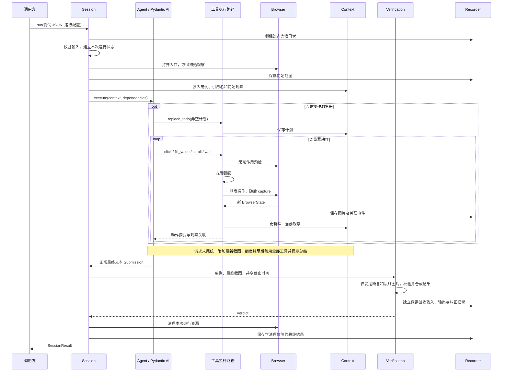

# UIProbe 系统架构

UIProbe 接收一份测试 JSON 和运行配置，运行一次浏览器测试会话。执行 Agent 阅读完整用例，使用 TODO 计划和工具操作页面，或直接根据初始观察提交。Agent 返回正常最终文本即形成 Submission。Session 随后启动独立视觉验收，释放资源并保存结果。

本文定义 module 划分、调用顺序、状态所有权与错误语义。文中 interface 表达目标设计，不表示所有类型及实现已经存在。

## 输入与基本概念

```json
{
  "execution": {
    "goal": "使用测试账号完成登录",
    "instructions": ["填写账号和密码", "提交登录表单"]
  },
  "assertions": [
    {"id": "home_visible", "expected": "显示登录后的首页"},
    {"id": "identity_visible", "expected": "用户菜单显示昵称 Alice"}
  ]
}
```

TestCase 是给定的执行说明和断言，Session 是一次完整运行。输入解析严格检查结构、未知字段和语义约束，聚合可确定的错误，不调用模型改写，也不猜测旧格式。

TODO 是 Agent 用工具维护的计划，不等同于输入说明。首次浏览器操作前必须成功创建非空计划；零动作可以直接提交，未完成 TODO 也不阻止提交。Submission 只说明执行结束，Verdict 才表达验收判断。

BrowserState 是一次实际观察，包含 PNG、会话内唯一截图编号、图片像素尺寸和同次 CSS 视口尺寸。截图表示观察时点，不保证页面稳定。数据引用名公开给 Agent，实际值留在 Browser。

## Module 与状态所有权

| Module | 对外职责 | 内部状态或规则 |
|---|---|---|
| Session | run(test_json, config) -> SessionResult | 生命周期、共享截止时间、动作预算、阶段结果、错误及收尾 |
| 输入解析 | prepare(test_json, config) | 合法 TestCase 和运行配置、字段错误聚合 |
| Agent | execute(context, dependencies) -> Submission | 框架循环、计划工具、工具纠正和提交 |
| Context | 状态访问及模型发送视图 | 用例、TODO、最新观察和完整框架历史 |
| 工具调用 | 在框架工具执行路径加入公共规则 | 计划门槛、预算、操作后截图、记录及工具禁用 |
| 具体工具 | 独立工具函数 | click、fill_value、scroll、wait、replace_todo 的语义和具体错误 |
| Browser | 页面操作及 capture | 单页面、固定视口、截图尺寸、坐标转换、实际引用值 |
| Verification | evaluate(test_case, screenshot, deadline_at) -> Verdict | 断言输入隔离、输出校验、纠正与总状态合成 |
| Recorder | begin、append、finish | 运行独立目录、全部历史与截图、验收材料和结果 |
| 模型连接 | 应用入口配置并注入客户端 | 连接配置和客户端关闭，不管理 Agent 循环 |

Session 对象只保存构造时注入的依赖，每次 run 的阶段结果保存在局部。每次运行独立创建 Browser、Context、RunBudget 和记录对象。工具只取得必要依赖，不取得整个 Session。

应用入口装配执行与验收模型，SessionConfig 不包含模型配置。两个角色可共用或分别使用客户端，历史始终独立。客户端由应用入口最终关闭，运行结束不关闭借用的模型连接。

## 执行顺序



该图表达正常路径。派发后的故障或本地写入失败停止后续执行，并进入收尾；未取得 Submission 时不启动验收。

## 框架与项目的分工

Pydantic AI 负责工具注册、参数类型校验、模型—工具循环、调用与结果配对、纠正反馈及框架预算。项目使用原生消息和工具集，不创建另一套 ToolSpec 或手写模型协议。

浏览器工具设置 sequential=true，使操作、截图和观察更新不与其他工具重叠；metadata.refresh_browser_state=true 标识项目动作路径。TODO 不刷新截图，不占浏览器动作数，允许非串行执行但遵守浏览器屏障。

各工具和 Browser 提供具体业务报错，LLM 决定修正；公共层只维护计划、额度和时间等共同限制。工具共用纠正配置，不加每工具重试次数或项目级重试计数器。派发后故障不自动重放。

## 浏览器观察与历史

Browser 首版单页面、固定视口，截图为原始当前视口，不缩放、不裁剪。click 只传截图编号和图片坐标，Browser 检查编号、范围并换算 CSS 坐标。fill_value 覆盖当前焦点输入框，不寻找替代目标；scroll 只滚动页面；wait 显式等待。操作后直接截图，不增加固定延迟。新窗口作为不支持的执行错误。

Context 保存完整原生历史，模型视图移除历史图片，在请求末尾仅附加最新图及编号和两组尺寸。文本与调用配对保留，不自动摘要。Recorder 在过滤前增量保存完整材料，末尾已过滤消息不能替代完整历史。产物用于复盘，不恢复中断执行。

## 预算与终止

deadline_at 是 run 开始时确定的单调时钟截止时间，覆盖准备、初始化、Agent 与验收。RunBudget 在无副作用校验通过后、实际派发前占用动作额度，已派发失败仍计数。初始化、TODO、验收不计浏览器动作。

最后一个允许动作及截图完成后禁用全部工具，包括 TODO，提示模型总结。仍提出的调用被拒绝，原有循环继续受模型请求、通用工具预算、纠正限制和截止时间约束。不增加独立总结阶段，不固定额外一次请求。没有正常最终输出就耗尽请求或时间时按执行错误结束。

## 独立验收

一次 evaluate 向视觉模型发送全部 assertions 和同一张最终截图，不发送 execution、TODO、执行历史或 Submission。模型只生成逐项 assertion_id、status、reason；程序校验 ID 一一对应、状态合法、依据非空，补截图编号并合成总状态。

可见支持为 passed，明确反例为 failed，无法判断为 error。任一 failed 则总状态 failed，全部 passed 才 passed，其余 error。合法失败不重试；格式错误可在额度和剩余时间内纠正。最终仍无合法完整输出时整份不接受，全部断言为 error，不拼接部分结论。程序不再增加第二个模型复核理由。

## 产物、错误与资源释放

Recorder 独占 output_dir/session_id，已存在目录不覆盖。保存 events.jsonl、执行 history.json、独立 verification.json、screenshots 和 result.json；先保存图片再写引用。最终结果以同目录临时写入后更名。

SessionResult 分别保存 stop_reason、errors、Submission 和 Verdict。SessionError 包含阶段、类别和安全原因。清理或本地记录失败使 Session 为 error，但不能覆盖已有验收结论。本地写入失败停止后续操作；在线遥测失败不改变结论，导出不含正文、图片或实际引用值。

异常、超时和取消后仍尝试释放资源并保存已有材料，使用独立短收尾时限，不继续页面或模型执行。外部取消经收尾继续传播。最终保存失败仍返回内存结果及已知可用路径，不能伪称文件已保存。

## 文档导航

[模块索引](modules/README.md) 列出各 module 的 interface 与内部职责；[共享契约](contracts.md) 定义数据和状态语义。模型连接现有实现位于 src/uiprobe/model_service.py，其存在不代表完整 Agent 和验收已实现。
