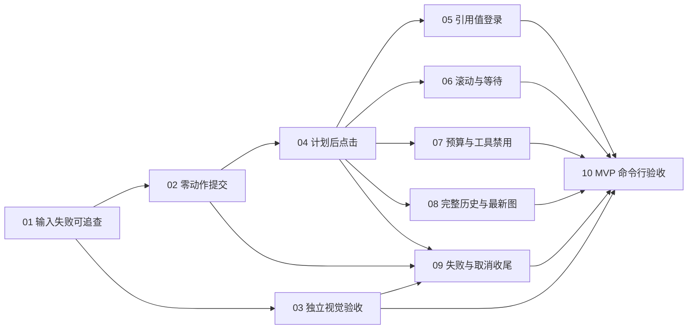

# UIProbe MVP 执行计划

## Purpose

调用方提供一份严格格式的测试 JSON 和运行配置，即可运行一次截图驱动的浏览器测试：执行 Agent 规划并操作页面或直接提交；独立视觉验收只看断言与最终截图；调用方取得 SessionResult 和可复盘的本地产物。首个真实演示是在本地登录页面使用数据引用完成登录，并验收首页可见。

本计划为待执行计划，不表示功能已实现。开发批次见 [execution.md](execution.md)，执行选择和待决问题见 [decisions.md](decisions.md)，实际状态见 [progress.md](progress.md)。

## Scope

覆盖输入解析、Session、RunBudget、Browser、执行 Agent 内部的 Context／工具调用／具体工具、Verification、Recorder，以及应用装配和最小命令行入口。实现五个工具：click、fill_value、scroll、wait、replace_todo。执行和验收可先复用同一个已装配的客户端，但消息及框架请求额度保持独立。

交付严格输入、固定视口单页面、截图坐标点击、引用值填写、完整本地历史、共享截止时间、动作预算、失败及取消收尾。只实现一次会话，不加入批量调度、多页面、DOM 验收、旧输入兼容、断点恢复、历史摘要或新一套模型协议。

在线 Langfuse／OTLP 导出不作为 MVP 门槛；本地记录是门槛。若保留框架自动遥测，必须验证其默认关闭或不会导出正文、图片及引用值。

## Design References

下列正式设计优先于 `.scratch/single-case-agent/` 中的历史讨论。

- [系统架构](../../design/system-architecture.md#module-与状态所有权)：模块划分和状态所有权。
- [共享契约](../../design/contracts.md#类型与所有权)：跨模块数据；[终态](../../design/contracts.md#提交验收和终态)定义 Submission、Verdict 与 SessionResult 的区别。
- [输入解析](../../design/modules/case-input.md#严格校验与内部流程)：严格输入及字段错误聚合。
- [Session](../../design/modules/runner.md#主流程)：阶段组织；[取消与收尾](../../design/modules/runner.md#取消与收尾)约束生命周期。
- [Agent](../../design/modules/agent.md#interface-与装配)：框架循环和提交。
- [Context](../../design/modules/context.md#完整历史与发送视图)：完整历史及唯一最新图片。
- [公共工具执行路径](../../design/modules/actions.md#浏览器动作路径)：计划、预检、额度、派发、截图和记录。
- [具体工具](../../design/modules/tools.md#工具-interface)：五个工具的参数和语义。
- [Browser](../../design/modules/browser.md#派发与故障)：派发前后错误；[坐标](../../design/modules/browser.md#截图与坐标)约束图片与 CSS 坐标。
- [Verification](../../design/modules/verification.md#模型输出与程序职责)：独立判断及确定性结果合成。
- [Recorder](../../design/modules/recording.md#内容及关联)：产物和完整历史；[写入失败](../../design/modules/recording.md#写入失败与终态)约束记录故障。
- [模型连接](../../design/modules/model.md#现有实现与接入方式)：复用现有客户端，不手写模型循环。

## Context And Orientation

已有 `src/uiprobe/model_service.py`、`tests/test_model_service.py`、`pyproject.toml` 和 `uv.lock`。现有连接使用 AsyncOpenAI，关闭 SDK 自动重试，并公开 client。其余正式模块尚未实现；已有测试不证明 Agent、浏览器或验收可用。

`login-demo/login.html` 是演示页面，演示账号为 admin，密码为 123456。`login-demo/test-cases.json` 是旧格式数组，不可直接作为新输入。新增单对象 MVP 用例及运行配置示例；断言只描述截图能支持的可见事实，不把地址栏 hash 或 DOM 隐藏属性作为视觉验收依据。凭证通过运行配置的 data_values 提供，执行说明仅使用引用名。

建议实现位置：跨模块值类型与输入放在 `src/uiprobe/` 下的独立模块；执行 Agent 按设计放入 `src/uiprobe/agent/`；Browser、Verification、Recorder、Session 各自独立。具体新增文件名由执行者按职责确定，测试仍采用 unittest。最小入口计划为 `src/uiprobe/__main__.py`，不新增 Web UI。

## Plan Of Work

里程碑描述可验收行为；ticket 按更窄的完整路径拆分。编号是计划内标识，不是已发布 tracker ID。

| 里程碑 | 交付行为 | 对应 ticket | 依赖 |
|---|---|---|---|
| M1 | 非法输入返回安全字段错误，并尽可能保存错误结果；不启动浏览器或模型 | 01 | 无 |
| M2 | 真实浏览器初始观察、框架零动作提交，以及独立视觉验收分别贯通 | 02、03 | 02 与 03 均依赖 01，可并行 |
| M3 | 计划后点击闭环，并扩展到引用值登录、滚动和等待 | 04、05、06 | 04 依赖 02；05、06 各依赖 04 |
| M4 | 有界工具循环、完整可回查历史、失败与取消终态成立 | 07、08、09 | 07、08 依赖 04；09 依赖 02、03、04 |
| M5 | 从命令行以真实模型完成登录和独立验收，并通过离线回归 | 10 | 03、05、06、07、08、09 |

### M1：输入失败可追查

贯通输入、Session 及 Recorder 的最窄错误路径，建立后续需要的值类型。有效配置下输入失败会生成 SessionResult 与本地错误产物；配置本身导致目录不可用时仍返回内存错误结果，不宣称文件已保存。完成标准：聚合确定的字段错误、无原始秘密值泄漏、浏览器和模型调用次数均为零。

### M2：零动作提交与独立验收

02 使用真实本地页面及可控模型响应，经过框架正常最终文本形成 Submission，保存首图并清理；该路径用注入的测试验收实现验证 Session 装配，不引入生产环境假验收。03 独立通过真实模型 adapter 的可控响应验证断言加 PNG 到 Verdict 和验收记录的路径。两条分支在 M5 联合验收。

完成标准：零动作无需 TODO、action_count 为零；验收输出映射及总状态准确；验收请求不含执行说明、TODO、提交或执行历史。

### M3：可操作的浏览器闭环

先贯通 replace_todo 和 click 的完整公共路径，再分别加入 fill_value 登录路径与 scroll／wait 观察路径。接口接合必须满足正式设计的派发时点和串行规则。

完成标准：过期截图及无效输入不会增加动作数；每个成功动作只生成一份新观察并先保存图片再引用；已派发故障不重放；使用引用值完成本地登录，不将实际引用值写入普通工具结果或事件。

### M4：有界执行与完整证据

在已经存在的闭环上完成动作额度耗尽、框架请求及纠正额度、消息视图、完整历史，以及超时、取消、本地记录及清理故障路径。各功能 ticket 自带常规错误处理；此阶段验证跨阶段组合，不把此前里程碑定义为可忽略资源释放的原型。

完成标准：最后一个动作后所有工具禁用；执行未正常提交时不验收；本地历史保留所有原生消息及图片关联，每次模型请求只含最新图片；收尾错误保留已有 Submission 和 Verdict，取消继续传播。

### M5：可从干净环境演示的 MVP

提供命令行装配、严格格式示例和安装运行说明。离线回归使用真实 Playwright 加可控模型响应；真实模型演示使用同一入口，不提供跳过验收或伪造成功的替代入口。

## Validation And Acceptance

整个 MVP 只有同时满足以下条件才完成：

1. 一条命令从新格式用例和配置运行本地登录，真实执行模型经工具完成登录，独立真实视觉模型返回与最终截图对应的 Verdict；保存模型名称、运行时间、session_id 和产物位置作为本地验证证据，不保存密钥。
2. 离线集成回归稳定证明正常提交、明确断言失败、证据不足、非法验收输出纠正耗尽等路径；不将“页面显示预期的登录失败提示”误判为测试失败，测试结论以断言内容为准。
3. 产物包括 events.jsonl、history.json、verification.json、screenshots/ 和 result.json；所有截图引用可解析，执行与验收历史隔离，已有目录不覆盖。
4. 严格输入、零动作、TODO 门槛、旧图、坐标比例、引用填写、串行动作、额度禁用、共享截止时间、取消及记录／清理失败通过可控场景验证。
5. 现有连接测试继续通过；普通回归不需要真实密钥、不调用收费服务。真实模型演示单列，未运行时明确为尚未完成，不可用模拟结果替代。

精确命令与预期输出见 [execution.md](execution.md#validation-commands)。

## Recovery

每个批次以可控测试验证后再继续；跨模块假设不成立时先记录发现并修订相关正式设计，再调整计划依赖。中断运行不恢复或重放浏览器动作；每次重试创建新的 session_id 和目录。不要覆盖旧 `.scratch` 讨论或现有未提交文件，不运行清理仓库的破坏性命令。

实施完成后，将四份计划文档作为整个目录移动到 `docs/exec-plans/completed/uiprobe-mvp/`，同时修正相对设计链接并重新校验。

## Related Documents

- [Execution](execution.md)
- [Decisions](decisions.md)
- [Progress](progress.md)
